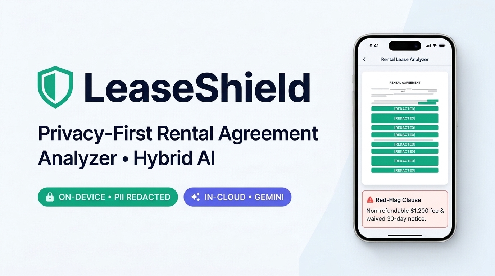

# LeaseShield



**Privacy-First Rental Agreement Analyzer powered by Firebase AI Logic Hybrid Inference**  
Built for Google's **#BuildHybridAI 2026 Hackathon** (Android + iOS Flutter App).

---

## Product Overview

Renters routinely hand over deeply sensitive documents—leases containing full names, SSNs/Aadhaar/PAN numbers, bank accounts, phone numbers, and home addresses—to cloud AI wrappers just to check for predatory clauses.

**LeaseShield** flips that paradigm using **Firebase AI Logic Hybrid Inference**:

1. **100% On-Device Privacy & Offline Triage:**
   - Captures a lease page via on-device **Google ML Kit OCR** (or one-tap built-in sample leases for instant Airplane Mode demos).
   - Runs **Gemini Nano 4** on Android (`firebase-ai` + `firebase-ai-ondevice`) or **Apple Foundation Models** on iOS (`FoundationModels` + `FirebaseAI`) locally to redact all PII and flag predatory clauses.
   - Displays a live **Glass Box Telemetry Pill** (`ON-DEVICE • Gemini Nano 4 • 340ms`).
2. **Transparent Cloud Escalation ("Draft Landlord Counter-Offer"):**
   - Before anything leaves the device, users and judges can tap **Inspect Payload** to view the exact outbound JSON and verify **ZERO PII** is transmitted.
   - Sends **only** the redacted clause excerpts + city/region to **Cloud Gemini** via Firebase AI Logic to draft a polite, firm counter-offer email grounded in regional tenant-protection norms (`IN-CLOUD • gemini-2.5-flash • 1,120ms`).

---

## Architecture Diagram

```mermaid
flowchart TD
    A["Lease Page Input\n(Camera/Gallery ML Kit OCR or 3 Sample Leases)"] --> B["HybridAiService\n(MethodChannel: com.leaseshield/hybrid_ai)"]
    B -->|"ONLY_ON_DEVICE / PREFER_ON_DEVICE"| C{"Native Firebase AI Logic Bridge"}
    C -->|"Android"| D["HybridAiPlugin.kt\nGemini Nano 4 (firebase-ai-ondevice)"]
    C -->|"iOS"| E["HybridAiPlugin.swift\nApple Foundation Models"]
    C -->|"Unsupported / Offline Fallback"| F["LocalPiiScrubber + LocalClauseDetector\n(100% On-Device Regex + Rules)"]

    D --> G["AnalysisBloc\nRedacted Lease + Red-Flag Clause Cards\nLive Telemetry Pill (ON-DEVICE)"]
    E --> G
    F --> G

    G -->|"User taps Draft Counter-Offer"| H["Glass Box Outbound Payload Inspector\n(Verifies ZERO PII before cloud call)"]
    H -->|"ONLY_IN_CLOUD\n(Redacted Clauses + Region only)"| I["Cloud Gemini via Firebase AI Logic\nProtected by Firebase App Check"]
    I --> J["NegotiationBloc\nCounter-Offer Email + Regional Norms\nLive Telemetry Pill (IN-CLOUD)"]

    G -->|"Anonymized Summary Only"| K["Cloud Firestore\nusers/{uid}/leases/{leaseId}"]
    J -->|"Anonymized Draft Only"| K
    L["Firebase Remote Config\nPrompt Templates & Default Triage Mode"] -.-> G
    L -.-> J
    M["Firebase Auth\nAnonymous Sign-In (Zero Friction)"] -.-> K
```



---

## Feature-First Project Structure

```text
lib/
├── core/
│   ├── config/          # AppConfig, FirebaseOptions, FirebaseBootstrap (App Check + Auth + Remote Config)
│   ├── di/              # get_it Service Locator
│   ├── hybrid_ai/       # MethodChannel client, telemetry DTOs, LocalPiiScrubber, LocalClauseDetector
│   └── theme/           # Material 3 Dark/Light design system (#0F172A, #10B981, #F59E0B, #EF4444, #6366F1)
├── features/
│   ├── scanner/         # On-device ML Kit OCR + 3 realistic pre-loaded sample leases
│   ├── analysis/        # AnalysisBloc, Live Hybrid Telemetry Bar, Red-Flag Cards, Redacted Document Viewer
│   ├── negotiation/     # NegotiationBloc, "Inspect Outbound Payload" modal, Cloud Gemini email generator
│   └── history/         # HistoryBloc + Firestore repository (users/{uid}/leases/{leaseId}, zero raw PII)
└── main.dart
android/app/src/main/kotlin/com/leaseshield/lease_shield/
└── HybridAiPlugin.kt    # Official firebase-ai + firebase-ai-ondevice bridge (Gemini Nano 4)
ios/Runner/
└── HybridAiPlugin.swift # Official FirebaseAI + Apple Foundation Models bridge
```

---

## How Firebase AI Logic Hybrid Inference Is Used

LeaseShield defines a unified, typed Flutter `MethodChannel` (`com.leaseshield/hybrid_ai`) supporting explicit routing modes:

| Mode | Behavior |
| :--- | :--- |
| `ONLY_ON_DEVICE` | Executes strictly on-device via Gemini Nano 4 (Android) or Apple Foundation Models (iOS). If unsupported hardware, runs `LocalPiiScrubber` + `LocalClauseDetector` locally—never touches the network. |
| `PREFER_ON_DEVICE` | Attempts on-device execution first. If the device lacks on-device model support, runs `LocalPiiScrubber` locally **before** escalating to Cloud Gemini and surfaces an amber transparency banner explaining the fallback. |
| `ONLY_IN_CLOUD` | Used exclusively for heavy-reasoning landlord counter-offer drafting using **only** verified redacted clause excerpts + city/region. |

Both native plugins return the exact same structured telemetry payload:
```json
{
  "text": "<structured JSON string>",
  "inferenceSource": "ON_DEVICE | IN_CLOUD",
  "latencyMs": 340,
  "modelName": "Gemini Nano 4 | Apple Foundation Models | gemini-2.5-flash"
}
```

---

## Firebase Stack & Judge Setup

### 1. Configure Firebase (FlutterFire CLI)
```bash
dart pub global activate flutterfire_cli
flutterfire configure --project=<your-firebase-project-id>
```
Ensure **Firebase AI Logic (Gemini Developer API)**, **Firebase App Check**, **Anonymous Authentication**, **Cloud Firestore**, and **Remote Config** are enabled in your Firebase Console.

> **Instant Offline Evaluation:** Even before running `flutterfire configure` (or in Airplane Mode), LeaseShield boots cleanly into offline-first mode so judges can test all 3 sample leases, PII redaction, red-flag detection, and the Outbound Payload Inspector immediately.

### 2. Firebase App Check Debug Token Setup (For Judges)
LeaseShield automatically uses `AndroidProvider.debug` / `AppleProvider.debug` in debug builds and `playIntegrity` / `appAttest` in release builds.

- **Android:** Run `flutter run` and copy the debug secret printed in Logcat:
  ```text
  D DebugAppCheckProvider: Enter this debug secret into the allow list in the Firebase Console: <UUID>
  ```
- **iOS:** Run from Xcode with `-FIRDebugEnabled` and copy the debug token from the Xcode console:
  ```text
  Firebase App Check debug token: <UUID>
  ```
- Register the token in **Firebase Console -> App Check -> Apps -> Manage debug tokens**.

### 3. Firebase Remote Config Parameters
Configure these optional keys in Firebase Remote Config (safe defaults are bundled in `AppConfig`):
- `red_flag_prompt_template` — Prompt template for on-device PII redaction & clause triage
- `negotiation_prompt_template` — Prompt template for Cloud Gemini counter-offer generation
- `default_triage_mode` — `"ONLY_ON_DEVICE"` (default) or `"PREFER_ON_DEVICE"`

---

## Build, Analyze & Test

```bash
# Install dependencies
flutter pub get

# Static analysis
flutter analyze

# Run unit & widget tests (LocalPiiScrubber, AnalysisBloc, NegotiationBloc, Telemetry UI)
flutter test

# Run on Android (minSdk 26+; Android 14+ AICore device for Gemini Nano 4)
flutter run -d android

# Run on iOS (iOS 16.0+; iOS 26+ Apple Intelligence device for Apple Foundation Models)
cd ios && pod install && cd ..
flutter run -d ios
```

---

## License

Licensed under the **Apache License, Version 2.0**. See [LICENSE](LICENSE) for details.


git remote add origin https://github.com/alnsmworld-tech/LeaseShield.git
git push -u origin main